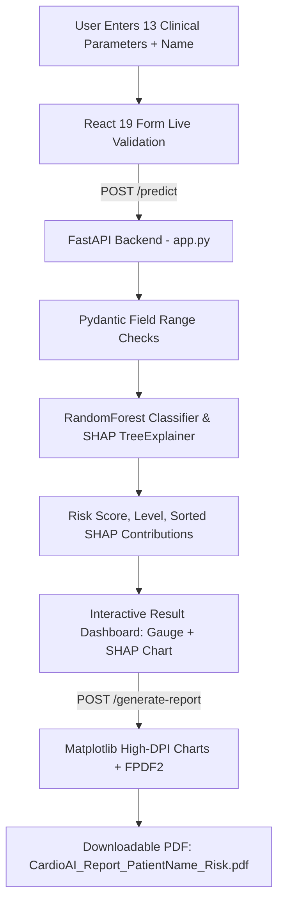

# 🫀 CardioAI: Advanced Heart Disease Risk Predictor


> **CardioAI** is a clinical-grade AI web application that evaluates **13 physiological and hemodynamic biomarkers** using a Random Forest ensemble to estimate cardiovascular risk. Featuring real-time **SHAP TreeExplainer** mathematical explainability, an exportable **PDF Medical Report** with server-side rendered charts, and a **Liquid Glass + Neumorphic** user interface in a curated medical red palette (`#830000`, `#BC0202`, `#FF0000`).

---

## ✨ Upgraded Features

### 1. 🛡️ Strict Clinical Input Validation
- **Bound Enforcement**: Pydantic Field constraints (`ge`/`le`) guard against out-of-distribution values (e.g. cholesterol 100-600 mg/dl, resting blood pressure 80-220 mmHg, age 18-100 yrs).
- **Clear Error Messaging**: Returns human-readable 422 error details specifying exact allowed boundaries.
- **Frontend Live Validation**: Form inputs feature real-time range bounds, inline warnings, and disabled submission states until all parameters are clinically valid.
- **Restored Diagnostic Parameter**: Restored the missing `restecg` (Resting Electrocardiogram: Normal, ST-T Abnormality, Left Ventricular Hypertrophy) field, ensuring complete 13-parameter model evaluation.
- **Patient Identity**: Captures Patient Name and threads it through all diagnostics and reports.

### 2. 🧠 Dynamic SHAP Explainability (TreeExplainer)
- Replaces static placeholder visuals with **live per-patient SHAP contributions** computed directly from the Random Forest model at inference time.
- Correctly isolates binary classification class 1 (disease presence) contributions.
- Recharts horizontal bar chart visually breaks down factors increasing risk (crimson red) versus reducing risk (teal-gray), complete with exact patient values in interactive tooltips and an 8 vs 13 feature expander.

### 3. 📄 Clinical-Grade PDF Medical Reports (`/generate-report`)
- **Header & Demographics**: CardioAI branding, unique Report ID, timestamp, patient name, and a 2-column clinical summary table translating raw codes into clinical terminology (e.g., "Typical Angina", "Normal Blood Flow").
- **High-DPI Server-Side Visualizations**: Generated via `matplotlib` (`Agg` backend) and embedded in-memory:
  - **Semicircular Risk Gauge**: Color-coded Low/Moderate/High zones with needle position and percentage readout.
  - **Feature Impact Bar Chart**: Top SHAP factor weights matching the app theme.
- **Personalized Medical Recommendations**: Dynamically evaluates patient blood pressure, cholesterol, exercise angina, ST depression, and peak heart rate to generate targeted lifestyle guidance.
- **Safe Rendering**: Unicode sanitization ensures fail-safe PDF generation with page numbers and clinical disclaimer.

### 4. 🎨 Red Design System (`#830000`, `#BC0202`, `#FF0000`)
- Built upon a medical-grade palette:
  - **Deep Maroon (`#830000`)**: Deep surfaces, typography, dark mode foundation.
  - **Crimson (`#BC0202`)**: Primary action buttons, active states, and high-impact indicators.
  - **Bright Red (`#FF0000`)**: Alert banners, high-risk states, and glowing accents.
- Supporting warm off-whites (`#FFF8F8`) and deep wine neutrals (`#0D0202`) guaranteeing WCAG AA contrast.
- Fully synchronized Light and Dark modes persisted via `localStorage`.

### 5. 💎 Neumorphism + Liquid Glass Aesthetic
- **Liquid Glass**: Translucent frosted containers (`backdrop-blur-xl`, `backdrop-saturate-150`), specular gradient borders, and ambient floating red liquid blobs.
- **Neumorphic Tactility**: Dual light/dark extruded surfaces on cards, inset depressed states for inputs, and custom range sliders.
- **Modular Component Hierarchy**: Refactored into clean modular units under `src/components/`:
  - `Landing.jsx`
  - `PatientForm.jsx`
  - `LoadingScreen.jsx`
  - `ResultScreen.jsx`
  - `RiskGauge.jsx`
  - `FeatureChart.jsx`
  - `ThemeToggle.jsx`

### 6. 💓 Anatomical Heart Hero & Animations
- **Centerpiece**: Realistic anatomical human heart line-art rendered with inline SVG featuring the aortic arch, vena cava, ventricles, and coronary arteries.
- **Self-Drawing Animation**: Uses SVG `stroke-dashoffset` path-drawing on load, transitions into a soft red gradient fill, and beats with a realistic double-beat (**"lub-dub"**) cardiac pulse.
- **Sweeping ECG**: Dynamic electrocardiographic rhythm line animates continuously beneath the heart.
- **Liquid Loading Screen**: Enforces an optimal minimum display duration (1.5s) to eliminate flicker while displaying animated cardiac scanning and rotating status text.

---

## 🏗️ Architecture & Data Flow



---

## 📂 Repository Structure

```text
.
├── app.py                     # FastAPI backend (predict, generate-report, CORS, SHAP)
├── train.py                   # Random Forest training script
├── test_app.py                # Pytest automated test suite
├── heart_disease_model.pkl    # Serialized Random Forest model
├── heart.csv                  # 1,025-row clinical training dataset
├── requirements.txt           # Python dependencies (shap, matplotlib, fpdf2, fastapi, etc.)
└── frontend/                  # React 19 + Vite + Tailwind client
    ├── src/
    │   ├── components/
    │   │   ├── Landing.jsx        # Anatomical heart hero & feature pillars
    │   │   ├── PatientForm.jsx    # 3-section form with live bounds validation
    │   │   ├── LoadingScreen.jsx  # Liquid-glass loading overlay with ECG sweep
    │   │   ├── ResultScreen.jsx   # Results view, gauge, clinical actions
    │   │   ├── RiskGauge.jsx      # Semicircular gauge with needle sweep animation
    │   │   ├── FeatureChart.jsx   # Dynamic SHAP bar chart (Recharts)
    │   │   └── ThemeToggle.jsx    # Light / Dark mode toggle
    │   ├── App.jsx            # State orchestrator
    │   ├── index.css          # Neumorphic utilities, liquid glass & theme tokens
    │   └── main.jsx           # React DOM root
    ├── tailwind.config.js     # Red palette, shadows, keyframe animations
    └── package.json           # Node scripts and dependencies
```

---

## 🚀 Setup & Execution

### 1. Backend Setup (FastAPI)
```bash
# Navigate to the project directory
cd Cardio-AI-Enhanced-version-of-Heart-Disease-Predictor--main

# Install Python requirements
pip install -r requirements.txt

# Run pytest test suite
pytest test_app.py

# Start the API server (available on http://127.0.0.1:8000)
python app.py
```

### 2. Frontend Setup (React / Vite)
```bash
# Navigate to the frontend directory
cd frontend

# Install Node dependencies
npm install

# Run the development server (proxies /predict & /generate-report to FastAPI)
npm run dev

# Or build production static assets
npm run build
```

---

## 🧪 Automated Testing

Run the test suite to verify validation guards, SHAP calculations, and PDF generation:

```bash
pytest test_app.py -v
```

Tests include:
- `test_validation_error_on_out_of_range_field`: Validates 422 error details when values (e.g. cholesterol) violate clinical bounds.
- `test_validation_error_on_age_and_bp`: Validates multiple simultaneous boundary errors.
- `test_valid_prediction`: Tests valid clinical inputs returning probability and risk classifications.
- `test_contributions_field`: Asserts all 13 SHAP feature impacts are returned, sorted descending by absolute value.
- `test_two_different_patients_produce_different_contributions`: Asserts distinct patients yield personalized factor impact profiles.
- `test_generate_report_valid_pdf`: Asserts `/generate-report` produces valid PDF binaries with embedded graphs.

---

## 📸 Screenshots & Visual Experience

| View | Description |
| :--- | :--- |
| **Landing Hero** | Anatomical SVG heart with "lub-dub" double pulse, sweeping ECG line, and glassmorphic cards in the `#830000` / `#BC0202` / `#FF0000` system. |
| **Diagnostic Form** | Grouped into 3 sections (Demographics, Vitals, Diagnostic Tests) with live range bounds, error feedback, and restored `restecg`. |
| **Loading Screen** | Full-screen liquid-glass modal with pulsing cardiac scan and cycling clinical status messages. |
| **Results Dashboard** | Semicircular animated gauge, percentage count-up, status card, and dynamic SHAP feature importance matrix. |
| **Medical PDF** | Multi-column PDF featuring patient demographics, matplotlib gauge, SHAP chart, personalized clinical recommendations, and legal disclaimer. |

---

## ⚕️ Clinical Disclaimer
CardioAI is intended solely for **educational, experimental, and preliminary screening purposes**. It does not constitute a certified medical diagnosis. Always consult a licensed medical professional or cardiologist for personal health evaluations.